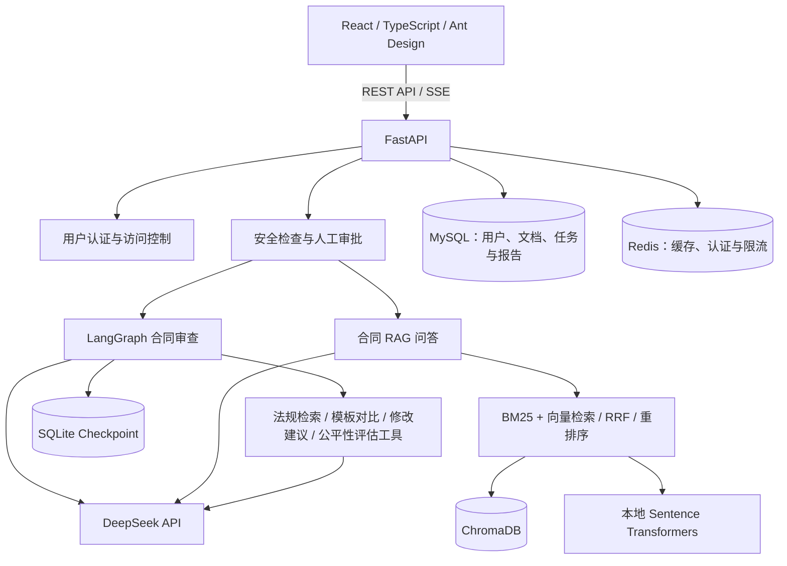
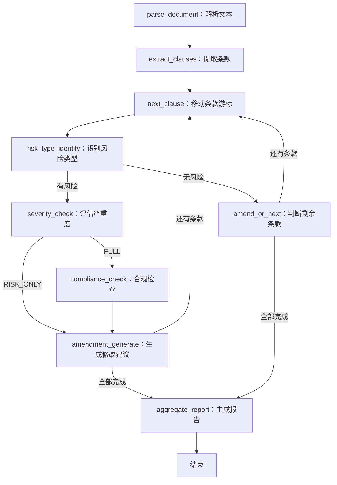

# smart-contract-review

一个基于 **LangGraph + FastAPI + React** 的智能合同审查 Agent 项目。

上传合同后，系统按条款识别潜在风险、评估风险等级、检索相关法规并生成修改建议，最终形成结构化审查报告。同时提供基于合同内容的 RAG 问答、SSE 实时进度、安全审批与评测功能。

## 功能概览

| 功能 | 说明 |
| --- | --- |
| 合同上传与解析 | 提取 PDF、DOCX、TXT 文本及部分表格内容，按条款拆分 |
| 条款风险识别 | 覆盖责任无限、付款约定模糊、单方解约、知识产权归属不明等 13 类预定义风险 |
| 风险分级 | 输出 HIGH、MEDIUM、LOW 风险等级与风险描述 |
| 合规检查 | 结合内置法规资料，为风险条款提供法律依据与合规分析 |
| 修改建议 | 生成条款修改建议，汇总评分、摘要和行动建议 |
| 合同智能问答 | 使用向量检索与 BM25 混合召回，回答问题并展示来源条款 |
| 实时进度 | 通过 SSE 推送条款分析、风险发现和任务完成等事件 |
| 安全与审批 | 规则过滤、AI 注入检测、工具调用守卫、人工安全审批及审计日志 |
| 状态持久化 | 使用 LangGraph 原生 SQLite checkpoint 保存图执行状态 |
| 评测 | 内置标注用例，支持风险类型指标、等级准确率与 LLM-as-Judge 评分 |

### 审查模式

- `FULL`：风险识别 → 严重度评估 → 合规检查 → 修改建议。
- `RISK_ONLY`：风险识别 → 严重度评估 → 修改建议，跳过合规检查。

无风险条款跳过后续风险分析节点，继续处理下一条款。

## 系统架构



默认使用 **DeepSeek** 生成审查和问答内容，使用 **Sentence Transformers** 在本地生成向量。二者独立配置。

### LangGraph 审查流程



当前图使用条件边和条款循环。原生 checkpoint 已接入审查执行，线程 ID 为 `review:{user_id}:{task_id}`，按用户与任务隔离状态。

人工安全审批在图执行前由业务服务处理，审批通过后重新启动审查；目前尚未接入 LangGraph 原生 `interrupt` / `Command(resume=...)`、API 断点续跑、子图或原生并行分支。

### RAG 问答流程

```text
用户问题
  → 查询改写
  → 问题路由与检索权重选择
  → ChromaDB 向量召回 + BM25 关键词召回
  → RRF 融合，低置信度时触发二次检索
  → Cross-Encoder 或 LLM 重排序
  → 按 Token 预算组装上下文
  → LLM 生成回答
  → 条款编号引用校验
```

引用校验用于检查回答中的条款编号是否与检索结果对应，不代表完整的法律事实核验。

## 技术栈

| 模块 | 技术 |
| --- | --- |
| 前端 | React 18、TypeScript、Vite、Ant Design、Zustand、Axios |
| 后端 | Python、FastAPI、Pydantic、SQLAlchemy AsyncIO |
| Agent 编排 | LangGraph 0.2.x、LangGraph Checkpoint SQLite |
| 大语言模型 | DeepSeek，支持通过 Provider 层切换 |
| Embedding | Sentence Transformers，默认 `paraphrase-multilingual-MiniLM-L12-v2` |
| 检索 | ChromaDB、BM25、jieba、RRF、Cross-Encoder |
| 数据与缓存 | MySQL 8、Redis 7、SQLite |
| 认证 | JWT、BCrypt、Redis Token 管理 |
| 工具 | 工具注册中心、合同审查工具、MCP Server 模块 |
| 部署 | Docker Compose、Nginx |

## 快速启动

推荐使用 Docker Compose 启动全部服务，无需另外手动启动虚拟机。

### 1. 准备环境

- 安装 Git 和 Docker Compose；Windows 可使用 Docker Desktop 的 Linux 容器模式。
- 启动 Docker 引擎。
- 准备可用的 DeepSeek API Key。
- 首次构建需要下载 Python、npm 依赖及模型文件，请预留网络与磁盘空间。

```bash
git clone https://github.com/3299339398/smart-contract-review.git
cd smart-contract-review
```

### 2. 配置环境变量

复制配置模板。已有 `.env` 时，直接编辑现有文件。

```bash
# Linux / macOS
cp .env.example .env
```

```powershell
# Windows PowerShell
Copy-Item .env.example .env
```

将 `.env` 中的占位值替换为自己的配置：

```dotenv
MYSQL_ROOT_PASSWORD=your-strong-mysql-root-password
MYSQL_PASSWORD=your-strong-mysql-password
REDIS_PASSWORD=your-strong-redis-password
DEEPSEEK_API_KEY=your-deepseek-api-key
JWT_SECRET=your-long-random-jwt-secret
```

`.env` 中保存的是本地凭据，不应提交到公开仓库。已有 MySQL 数据卷时，密码必须与卷内账户一致；仅修改 `.env` 不会重置数据库密码。

### 3. 构建镜像并准备向量模型

当前 Compose 将外部卷 `scr_embedding_model` 挂载到 `/app/embedding_model`。首次部署需要创建该卷，并将模型保存到这个目录；空卷不包含可用模型。

在项目根目录依次执行以下命令，PowerShell 和 Bash 均可使用：

```bash
docker volume create scr_embedding_model
docker compose build
docker compose run --rm --no-deps fastapi python -c "from sentence_transformers import SentenceTransformer; SentenceTransformer('sentence-transformers/paraphrase-multilingual-MiniLM-L12-v2').save('/app/embedding_model')"
```

模型下载只需在首次部署或模型卷被清空后执行。默认 Cross-Encoder 重排序模型会在首次使用时另行下载。

### 4. 启动服务

```bash
docker compose up -d
docker compose ps
docker compose logs -f fastapi
```

| 服务 | 访问地址 / 本机端口 |
| --- | --- |
| 前端 | <http://localhost:3000> |
| Swagger API 文档 | <http://localhost:5001/docs> |
| 后端健康接口 | <http://localhost:5001/health> |
| MySQL | `127.0.0.1:3307` |
| Redis | `127.0.0.1:6380` |
| ChromaDB | `127.0.0.1:8001` |

MySQL、Redis 和 ChromaDB 通过健康检查后，后端才开始启动。后端启动时会尝试自动创建数据库表。

健康接口返回 `{"status":"UP"}` 仅表示 API 进程可响应；还应检查后端日志中是否存在数据库连接或模型初始化错误。

### 5. 使用项目

1. 打开前端，注册账号并登录。
2. 上传合同，等待文本解析与索引建立。
3. 选择 `FULL` 或 `RISK_ONLY` 模式，创建审查任务。
4. 查看实时进度、风险条目与最终报告。
5. 进入合同问答页，基于该合同提出问题并查看引用来源。
6. 如触发人工安全审批，可通过安全审批 API 处理，接口见 Swagger。

仓库提供 `sample_labor_contract.docx`，可用于上传体验。

### 停止与重新启动

```bash
# 停止并移除服务容器，保留数据卷
docker compose down

# 再次启动
docker compose up -d

# 修改后端配置后重新创建后端容器
docker compose up -d fastapi

# 修改代码后重新构建并启动
docker compose up -d --build
```

业务数据库、缓存、向量数据、上传文件与 checkpoint 使用 Docker volume 保存。评测 API 生成的 JSON 报告目前保存在后端容器的 `data/eval_reports`，如需跨容器重建保留，需另行配置目录挂载。

## 本地开发

可以仅用 Docker 启动中间件，在宿主机运行前后端。建议使用 Python 3.11+ 和 Node.js 20。

### 启动中间件

先完成根目录 `.env` 配置，然后在项目根目录执行：

```bash
docker compose up -d mysql redis chromadb
```

### 启动后端

进入 `backend-python`，创建虚拟环境：

```bash
cd backend-python
python -m venv .venv
```

```powershell
# Windows PowerShell
.\.venv\Scripts\Activate.ps1
```

```bash
# Linux / macOS
source .venv/bin/activate
```

激活环境后安装依赖：

```bash
python -m pip install -r requirements.txt
```

在 `backend-python/.env` 中配置后端连接信息。该文件与根目录供 Compose 使用的 `.env` 分别加载，数据库及 Redis 密码应保持一致：

```dotenv
MYSQL_HOST=127.0.0.1
MYSQL_PORT=3307
MYSQL_USER=scr_user
MYSQL_PASSWORD=your-strong-mysql-password
MYSQL_DATABASE=contract_review
REDIS_HOST=127.0.0.1
REDIS_PORT=6380
REDIS_PASSWORD=your-strong-redis-password
CHROMA_HOST=127.0.0.1
CHROMA_PORT=8001
DEEPSEEK_API_KEY=your-deepseek-api-key
JWT_SECRET=your-long-random-jwt-secret
EMBEDDING_MODEL=paraphrase-multilingual-MiniLM-L12-v2
LANGGRAPH_CHECKPOINT_PATH=./data/checkpoints.sqlite
```

在 `backend-python` 目录运行：

```bash
python -m uvicorn app.main:app --host 127.0.0.1 --port 5001 --reload
```

本地 Embedding 默认按模型名称加载，首次使用需要联网下载，也可将 `EMBEDDING_MODEL` 设置为已下载模型的本地目录。

### 启动前端

新开终端，在项目根目录执行：

```bash
cd frontend
npm ci
npm run dev
```

访问 <http://localhost:5173>。Vite 已将 `/api` 请求代理到 `http://localhost:5001`。

## 主要 API

统一前缀为 `/api/v1`。业务接口使用 `Authorization: Bearer <accessToken>` 认证，完整参数及响应结构见 Swagger。

| 方法 | 路径 | 说明 |
| --- | --- | --- |
| POST | `/auth/register` | 注册账号 |
| POST | `/auth/login` | 登录并获取 Token |
| POST | `/auth/refresh` | 刷新 Token |
| POST | `/documents/upload` | 上传合同，使用 multipart 字段 `file` |
| GET | `/documents` | 获取文档列表 |
| POST | `/reviews` | 创建审查任务 |
| GET | `/reviews/{task_id}` | 查询任务状态 |
| GET | `/reviews/{task_id}/stream` | 订阅 SSE 审查进度 |
| GET | `/reviews/{task_id}/result` | 获取审查报告 |
| POST | `/consultations` | 提交合同问题 |
| GET | `/security/approvals` | 获取待审批记录 |
| POST | `/security/approvals/{approval_id}/approve` | 批准安全审批 |
| POST | `/security/approvals/{approval_id}/reject` | 拒绝安全审批 |
| GET | `/security/audit-logs` | 查询安全审计日志 |
| POST | `/eval/run` | 启动评测 |
| GET | `/eval/reports` | 获取评测报告列表 |

创建审查任务的请求体：

```json
{
  "documentId": 1,
  "reviewType": "FULL"
}
```

提交合同问题的请求体：

```json
{
  "documentId": 1,
  "question": "这份合同中，提前解除合同需要承担什么责任？"
}
```

## 测试与评测

### 后端测试

在已配置依赖和环境变量的本地后端环境中运行：

```bash
cd backend-python
python -m pip install pytest
python -m pytest tests -q
```

当前测试主要覆盖 RAG 与合同审查工具。部分测试需要向量模型或 LLM 配置，不是完整的端到端验证。

### Agent 评测

内置 10 条标注用例，支持风险类型 Precision / Recall / F1、风险等级准确率和 LLM-as-Judge 评分。评测会调用模型，结果受模型、配置和样本规模影响。

```bash
# 在 backend-python 目录执行
python -m eval.cli --all
python -m eval.cli --all --full
python -m eval.cli --case 3
python -m eval.cli --all --no-judge
python -m eval.cli --all --export report.json
```

也可以在服务启动后使用容器中的评测命令：

```bash
docker compose exec fastapi python -m eval.cli --all --no-judge
```

### 前端构建

```bash
cd frontend
npm run build
```

## 项目结构

```text
smart-contract-review/
├── backend-python/
│   ├── app/
│   │   ├── agent/          # LangGraph 状态、节点、条件边与 checkpoint
│   │   ├── api/            # 认证、文档、审查、问答、安全与评测接口
│   │   ├── core/           # LLM / Embedding Provider 与工具注册中心
│   │   ├── embeddings/     # 向量生成与 ChromaDB 封装
│   │   ├── rag/            # 混合召回、重排序、上下文组装与引用校验
│   │   ├── mcp/            # 合同审查工具与 MCP Server 模块
│   │   ├── security/       # 规则过滤、风险分类、工具守卫与人工审批
│   │   ├── services/       # 业务服务与 SSE 推送
│   │   ├── models/         # SQLAlchemy 数据模型
│   │   ├── schemas/        # API 请求与响应模型
│   │   ├── cache/          # 内存与 Redis 缓存
│   │   ├── parser/         # 文档解析与条款分块
│   │   ├── config.py       # 后端配置
│   │   └── main.py         # FastAPI 入口
│   ├── data/regulations/   # 内置法规资料
│   ├── eval/               # 标注用例、评分与评测 CLI
│   ├── tests/              # 后端测试
│   └── requirements.txt
├── frontend/
│   ├── src/pages/          # 登录、文档、审查、问答与评测页面
│   ├── src/hooks/          # 认证与 SSE 等 Hook
│   └── nginx.conf         # 静态资源与 API 反向代理
├── docker-compose.yml
├── .env.example
├── PROJECT-GUIDE.md
└── sample_labor_contract.docx
```

## 常见问题

**是否需要启动虚拟机？**

不需要单独启动 VMware 或 VirtualBox。使用 Docker Desktop 即可运行 Compose 中的服务；`vm-start-services.sh` 是另外提供的中间件部署脚本。

**提示缺少 `scr_embedding_model` 或模型无法加载？**

按快速启动第 3 步创建模型卷并下载模型。仅创建空 volume 不足以完成模型准备。

**服务启动了，但审查无法调用模型？**

确认 `DEEPSEEK_API_KEY` 有效，并检查网络、API 余额及 `docker compose logs fastapi`。修改根目录 `.env` 后，执行 `docker compose up -d fastapi` 使配置生效。

**MySQL 提示 `Access denied`？**

检查 `.env` 中的账号密码是否与已有数据卷一致。MySQL 初始化变量只在首次初始化数据目录时生效，不要通过删除已有数据卷解决密码问题。

**支持扫描件或旧版 `.doc` 吗？**

当前主要支持包含文本的 PDF、DOCX 和 UTF-8 TXT，未集成 OCR。旧版二进制 `.doc` 建议先转换为 `.docx`。

**checkpoint 是否意味着重启后自动续跑？**

目前已持久化图状态，但业务 API 尚未接入从 checkpoint 恢复任务的入口。服务重启后不会自动继续未完成任务。

## 使用说明

本项目用于智能合同审查的学习、开发与辅助分析，生成的风险判断和修改建议需要结合合同背景及最新法律规定进行人工复核。合同内容会按需发送至配置的模型服务，请使用有权处理的材料。
